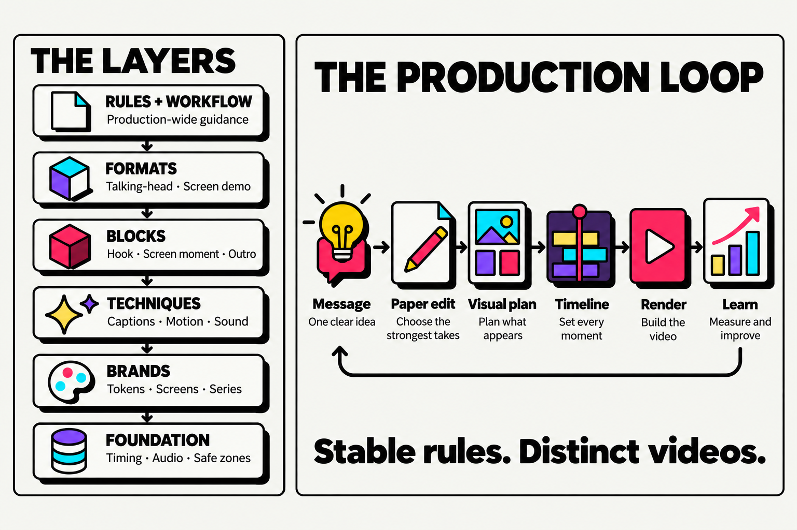

# Frame-Sliced Design

**A modular production framework for vertical short-form video.**

Frame-Sliced Design (FSD) helps creators and small teams make TikTok, Instagram Reels, and YouTube Shorts with a repeatable process—while leaving each video room to feel distinct.

It organizes production like a design system: reusable rules, formats, blocks, techniques, brand assets, and foundational tokens. Plan the edit before rendering, assemble only the pieces a story needs, then use audience response to improve the system.



The left stack shows the dependency order: each upper layer can use the layers beneath it. The right shows the production loop from an idea through rendering and learning. The tables below name each layer and step.

## Why use a framework?

Short-form video has recurring constraints: a small vertical canvas, platform controls over the image, viewers who may watch without sound, and only a few seconds to earn attention. At the same time, recurring series need consistency without making every episode feel identical.

FSD makes repeatable decisions reusable and keeps creative decisions visible. It combines:

- **Feature-Sliced Design:** a layered structure with one-way dependencies and independent slices.
- **Atomic Design and design tokens:** small pieces combine into larger compositions, with shared values defined once.
- **Editing and visual storytelling:** a decision hierarchy, contrast and pacing principles, and format bibles.

The result is a library and workflow for planning, editing, rendering, reviewing, and learning from vertical video.

## The layers

Each layer can use the layers below it. Slices at the same level stay independent, so a technique can change without forcing unrelated formats or blocks to change.

| Layer | FSD analogy | What belongs here |
|---|---|---|
| `rules/` + `workflow/` | app | Production-wide constraints and the production process |
| `formats/` | pages | Format structures and their fixed and variable parts |
| `blocks/` | widgets | Reusable compositions such as hooks, screen moments, and outros |
| `techniques/` | features | Independent editing techniques such as captions, motion, and sound design |
| `brands/` | entities | Brand tokens, product screens, series bibles, and video plans |
| `foundation/` | shared | Default timing, loudness, motion, and safe-zone values |

Every slice has a README that acts as its public interface: what it does, when to use it, and how it relates to other pieces.

## A typical production

1. Define the video's one-sentence message and write the spoken script.
2. Record and transcribe the takes.
3. Build a paper edit: choose the best take for each line and remove repetition.
4. Create a visual plan and intensity curve. Decide what appears on each line before rendering.
5. Convert the approved plan into `timeline.json`.
6. Preview still frames, render the video, and review it on a phone with sound on and off.
7. Publish, record what was used, and add performance learnings to the series log.

The workflow has three explicit approval checkpoints: the visual plan, the full draft, and the final video. See [the first-video walkthrough](start/first-video.md) for the complete process.

## Render tool

`tools/render/` includes a JavaScript command-line tool that turns a timeline and media assets into a vertical video. Its commands cover transcription, cutting, still previews, audio mixing, and rendering.

```sh
cd tools/render
npm install
npx playwright install chromium

node fsd.mjs stills timeline.json --assets screens/ --times 1 5 --out stills/
node fsd.mjs render timeline.json --base cut/base.mp4 --voice cut/voice.m4a \
  --assets screens/ --brand brand.json --out final.mp4
```

The renderer uses Node.js, Playwright with Chromium, and FFmpeg. Transcription is optional and uses `sherpa-onnx-node` with a local Whisper model. See the [render tool guide](tools/render/README.md) for setup, commands, and the timeline schema.

The render path has been visually and audibly compared with an approved reference video. The `cut` and `transcribe` commands have not yet been exercised in a real production, so treat them as experimental.

## Start here

- New to the method? Follow [Start here](start/README.md).
- Making your first video? Use the [step-by-step walkthrough](start/first-video.md).
- Setting up a brand? Copy the [brand-pack template](start/brand-pack.md).
- Looking for a particular production step? Browse [the workflow](workflow/README.md), [techniques](techniques/README.md), or [blocks](blocks/README.md).
- Curious about the ideas behind the framework? Read [the lineage](lineage.md).

## Repository map

```text
rules/ + workflow/  production-wide rules and process
formats/            repeatable video structures
blocks/             reusable visual and narrative compositions
techniques/         independent editing techniques
brands/             brand, series, and video templates
foundation/         default design and audio tokens
start/              onboarding and tutorials
learning/           post-publication learning loop
tools/render/       timeline-based video renderer
```

Brand-specific assets—logos, product screenshots, raw footage, and exports—belong in a private brand pack, not in this framework repository. The `brands/_template/` directory provides structure without real brand material.

## Design principles

1. **Stable system, distinct videos.** Keep brand and series identity consistent while choosing story-specific pieces.
2. **Resolve conflicts by priority.** Message, emotion, rhythm, readability, brand, then decoration.
3. **Plan before rendering.** Make creative decisions in the paper edit and visual plan before the expensive render step.
4. **Use contrast to shape attention.** Place varied emphasis moments at the peaks of the intensity curve.
5. **Keep pieces independent.** Each technique and block has a clear interface and can evolve on its own.
6. **Learn from every release.** Record performance, review patterns, and update the framework deliberately.

## Contributing

Contributions should preserve the layer boundaries and keep each slice's README up to date. Read [Contributing](CONTRIBUTING.md) for the commit convention and [CLAUDE.md](CLAUDE.md) for repository guidance.

## License

No license file is included yet. Add a license before granting public reuse rights.
