# İlk videon: adım adım (talking-head)

Bu öğretici bir talking-head videosunu ham çekimden yayına kadar götürür. Her adım aynı yapıda:

- **Amaç:** bu adım neden var
- **Girdi → Çıktı:** ne ile başlıyorsun, ne ile bitiyorsun
- **Yap:** somut işlemler ve komutlar
- **Kontrol:** bir sonraki adıma geçmeden önce
- **Gün 1'de:** [Rota Gün 1](../examples/rota-day-1/README.md) örneğinde nasıl göründüğü

Üç onay noktası var: ✅ 5. adım (plan), ✅ 8. adım (tam taslak), ✅ 9. adım (final).

```
0 Hazırlık → 1 Çekim → 2 Transkripsiyon → 3 Kâğıt kurgu → 4 Kesim
→ 5 Görsel plan ✅ → 6 Timeline → 7 Stills → 8 Render ✅ → 9 Kontrol ✅ → 10 Yayın ve kayıt
```

---

## 0. Hazırlık

**Amaç:** Aracı kurmak ve markanın, serinin kurallarını okumak.
**Girdi → Çıktı:** boş bilgisayar → çalışan araç, okunmuş marka paketi

**Yap**
```
git clone https://github.com/violettance/frame-sliced-design
cd frame-sliced-design/tools/render
npm install
npx playwright install chromium
```
FFmpeg kurulu olmalı (`ffmpeg -version`). Transkripsiyon için ayrıca `npm install sherpa-onnx-node` ve bir Whisper modeli (bkz. [tools/render](../tools/render/README.md)).

Marka paketinden şunları oku:
- `brand.md`: ton, adlandırma, yasaklar
- serinin `bible.md`'si: sabitler ve değişkenler
- serinin `log.md`'si: bir önceki bölümde kullanılan hook ve vurgu tipleri **bu bölümde kullanılamaz**

**Kontrol**
- [ ] `node fsd.mjs` komutu kullanım bilgisini yazıyor
- [ ] Bu bölümde kullanılamayacak hook ve vurgu tiplerini biliyorsun

**Gün 1'de:** Seri yeni olduğu için günlük boştu. Gün 2 için günlükte "hook: kinetic-labels kullanılamaz" notu var.

---

## 1. Çekim

**Amaç:** Kurguyu kolaylaştıran ham malzeme.
**Girdi → Çıktı:** kısa metin → bir ya da birkaç take (dikey video)

**Yap**
- Tek cümlelik mesajı ve kısa metni yaz. Kısaltma kullanma, doğal konuş.
- Cümleler arasında ~1 saniye dur; takılınca cümleyi baştan söyle.
- Ekranı göstereceğin yerde jestini planla (ör. parmakla sağ üstü göster); ekran o köşede belirecek.
- Işığı sabit tut, bütün take'leri aynı oturumda çek.

**Kontrol**
- [ ] Her cümlenin en az bir temiz take'i var
- [ ] Ses net (yaka mikrofonu)

**Gün 1'de:** Metin önceden yazılmadığı için iki take farklı içerikte çıktı; kurgu bu yüzden uzadı.

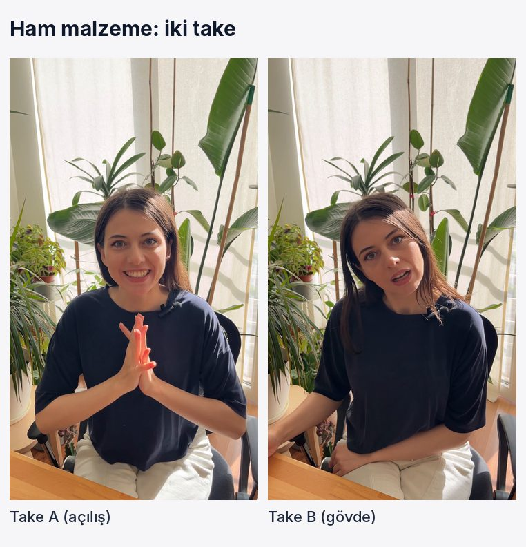

---

## 2. Transkripsiyon

**Amaç:** Kâğıt kurgu için her cümlenin zamanını bilmek.
**Girdi → Çıktı:** take'ler → cümle zamanlı metin (`phrases.json`)

**Yap**
```
node fsd.mjs transcribe IMG_1123.MOV --model whisper-turbo/ --out take-b.json
```
Çıktı her cümleyi başlangıç ve bitiş saniyesiyle verir:
```
  20.94-  23.85 Sen sorularını çözdükçe Rota seni tanıyor.
  25.65-  29.81 Nerede iyisin, nerede takılıyorsun, nerede gelişme noktaların var?
  32.02-  33.41 Bir de içinde koçun var.
```

**Kontrol**
- [ ] Bütün take'ler döküldü
- [ ] Anlamsız satırlar (çekim arası konuşmalar) fark edildi; kâğıt kurguda atılacak

**Gün 1'de:** İki take döküldü. "Tanka tanka", "noldu" gibi çekim arası konuşmalar burada göründü.

---

## 3. Kâğıt kurgu

**Amaç:** Videoyu render etmeden metin üzerinde kurmak. Render en pahalı adımdır.
**Girdi → Çıktı:** dökümler → [kâğıt kurgu şablonu](../workflow/templates/paper-edit.md) + `edit.json`

**Yap**
1. Her cümle için en temiz take'i seç.
2. Tekrar eden fikirleri, takılmaları ve dağınık cümleleri at; atılanları nedeniyle birlikte şablona yaz.
3. Sadece dinlenince hikâyenin anlaşıldığından emin ol.
4. Video son cümlede biter; sesli "takip et" yok.
5. Seçimi `edit.json`'a çevir:
```json
{
  "sources": { "A": "IMG_1122.MOV", "B": "IMG_1123.MOV" },
  "pieces": [
    { "src": "A", "in": 0.00, "out": 6.08 },
    { "src": "B", "in": 46.31, "out": 51.26, "hardOut": true }
  ]
}
```
`in`/`out` konuşmanın başladığı ve bittiği yer. Arkasından istenmeyen bir kelime geliyorsa `hardOut: true`.

**Kontrol**
- [ ] Tekrar eden fikir yok
- [ ] Her parçanın neden seçildiği/atıldığı yazılı

**Gün 1'de:** 11 parça kaldı. "Sana 7/24 cevap veriyor" ("gece 2'de" ile aynı fikir), uzun haftalık plan cümlesi ve sesli "bizi takip et" atıldı. Tam tablo: [örnek, bölüm 1](../examples/rota-day-1/README.md#kâğıt-kurgu).

---

## 4. Kesim

**Amaç:** Kâğıt kurgudan temiz ses ve kesilmiş görüntü üretmek.
**Girdi → Çıktı:** `edit.json` + take'ler → `voice.m4a`, `base.mp4`, `pieces.json`

**Yap**
```
node fsd.mjs cut edit.json --out-dir cut/
```
Araç her parçaya nefes payı bırakır, kelime sonlarını yutmaz, sesi temizler (−16 LUFS) ve görüntüyü kare hassasiyetinde keser. `pieces.json` her parçanın videoda nerede başladığını verir; bunlar timeline'daki `segments` olur.

**Kontrol**
- [ ] `voice.m4a`'yı baştan sona dinle: kesik kelime, yapışık cümle yok
- [ ] Hiçbir ara 0,6 saniyeyi geçmiyor

**Gün 1'de:** 56 sn'lik ilk kurgu, tekrarlar atılınca 46 sn'ye, sesli takip çağrısı da çıkınca 41,8 sn'ye indi.

---

## 5. Görsel plan ve yoğunluk eğrisi ✅

**Amaç:** Her cümlede ne görüneceğine render'dan önce karar vermek.
**Girdi → Çıktı:** kesilmiş ses + metin → [görsel plan](../workflow/templates/visual-plan.md) + [yoğunluk eğrisi](../workflow/templates/intensity-curve.md)

**Yap**
1. Her cümleye bir görüntü ata: **sen** · **ekran** · **vurgu** · **blok** · **geçiş**.
2. Ekran sadece söylenenle birebir eşleşiyorsa gelir. Okunması gerekiyorsa büyür ([screen-moment](../blocks/screen-moment/README.md)).
3. Yoğunluk eğrisini çiz. Vurguları zirvelere yerleştir, her zirvede farklı tip kullan ([emphasis](../techniques/emphasis/README.md)).
4. Hook tipini seç; bir önceki bölümle aynı olamaz ([hook](../blocks/hook/README.md)).
5. En az bir yeni öğe öner.

**Kontrol**
- [ ] Altyazı + büyük yazı + yoğun ekran aynı anda yok
- [ ] Yazılar yüzü kapatmıyor
- [ ] ✅ Kesilmiş metin, görsel plan ve eğri tek mesajda onaya gitti

**Gün 1'de:**

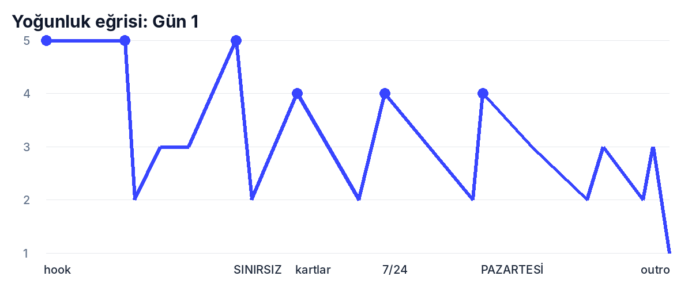

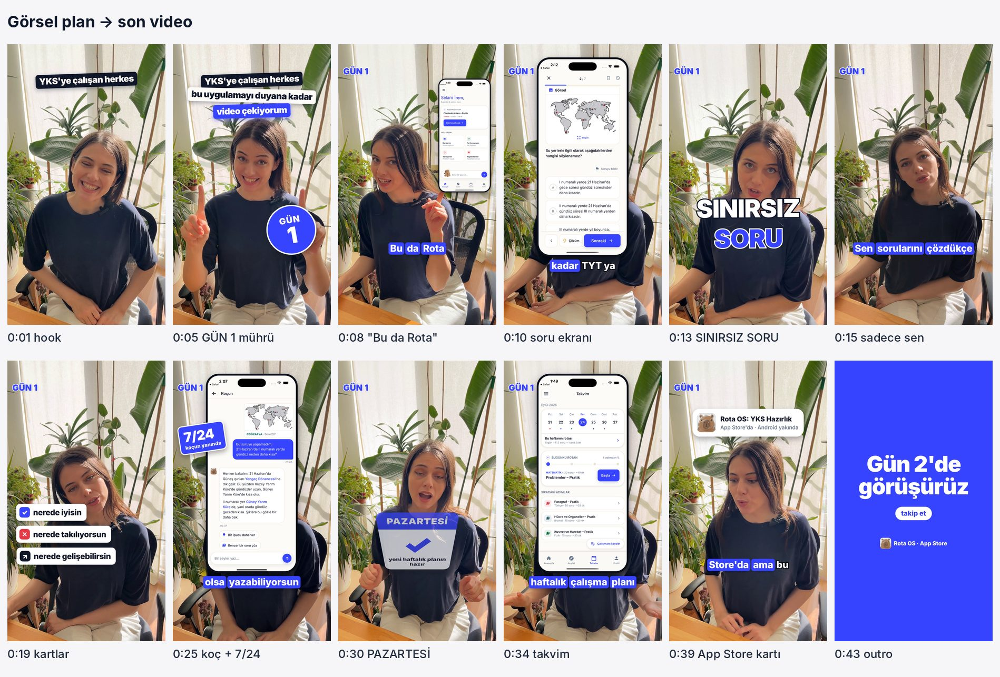

---

## 6. Timeline

**Amaç:** Onaylanan görsel planı aracın okuyacağı tek dosyaya çevirmek.
**Girdi → Çıktı:** görsel plan + kelime zamanları → `timeline.json`

**Yap:** Görsel plandaki her satır timeline'da bir alana karşılık gelir:

| Görsel planda | timeline.json'da |
|---|---|
| Hook satırları | `hook.lines[]` (`text`, `at`, `style`) |
| "GÜN X" mührü | `emphasis[]` → `stamp` |
| Ekran anı | `screenMoments[]` (`from`, `to`, `anchor`, `grow`, `screens`, `tap`) |
| Büyük yazı, kartlar, etiket, yaprak | `emphasis[]` → `big-kinetic`, `stacked-chips`, `sticker`, `page-flip` |
| Geçiş | `transitions[]` (`at` = kesim anı) |
| Yakınlaşma | `zoom.segments[]` |
| Efekt sesi, müzik boşluğu | `audio.sfx[]`, `audio.music.dips` |
| Kapanış | `outro` |

Örnek bir ekran anı (Gün 1, "Bu da Rota"):
```json
{ "from": 7.45, "to": 13.2, "anchor": "top-right", "grow": 9.45,
  "screens": [["home", 7.45], ["soru", 9.3]],
  "tap": { "at": 9.12, "x": 128, "y": 369 } }
```
Alanların tamamı: [tools/render](../tools/render/README.md#timelinejson). Tam örnek: [examples/rota-day-1/timeline.json](../examples/rota-day-1/timeline.json).

**Kontrol**
- [ ] Görsel plandaki her satırın timeline'da karşılığı var
- [ ] Zamanlar kelime zamanlarıyla örtüşüyor (ekran, ilgili kelimede geliyor)

---

## 7. Stills

**Amaç:** Tam render'dan önce birkaç kareyi saniyeler içinde görmek.
**Girdi → Çıktı:** `timeline.json` → seçilen saniyelerin görsel katmanı

**Yap**
```
node fsd.mjs stills timeline.json --assets screens/ --brand brand.json --times 5.8 20 34 --out stills/
```

**Kontrol**
- [ ] Yerleşim, renkler ve yazı boyutları doğru
- [ ] Ekranlar okunuyor

**Gün 1'de:**

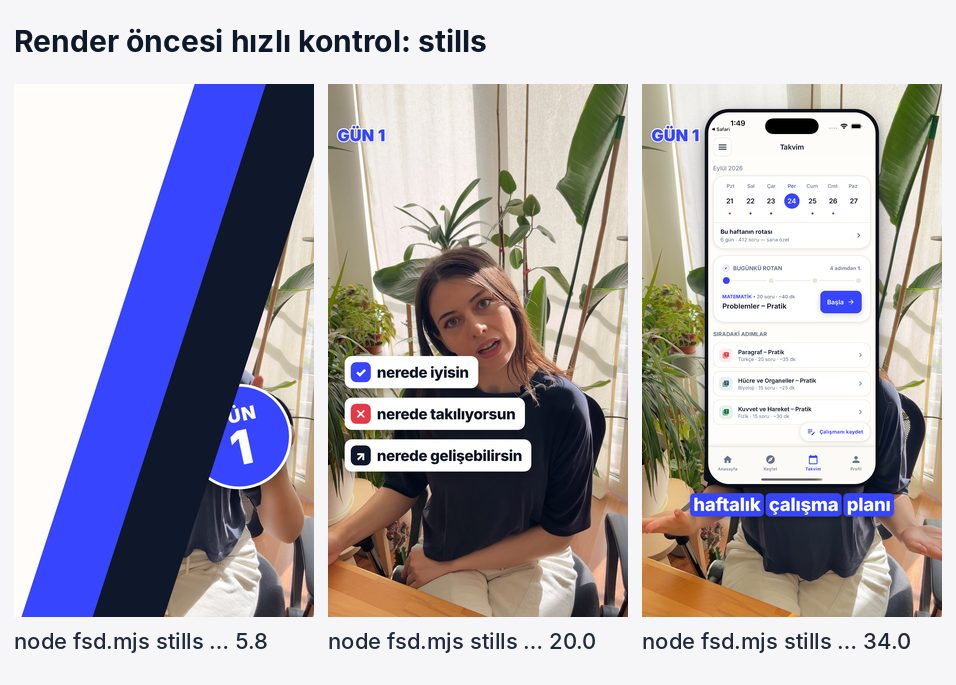

---

## 8. Render ✅

**Amaç:** Videoyu üretmek.
**Girdi → Çıktı:** `base.mp4` + `voice.m4a` + `timeline.json` + marka paketi → `final.mp4`

**Yap**
```
node fsd.mjs render timeline.json --base cut/base.mp4 --voice cut/voice.m4a \
    --assets screens/ --sfx-dir sfx/ --brand brand.json --out final.mp4
```
Araç sırasıyla: sesi miksler (müzik konuşma altında kısılır, boşluklarda yükselir, işaretli yerlerde susar), her kareyi çizer (yakınlaşma, parça parça renk eşitleme, görsel katman) ve kodlar. 43 saniyelik bir video yaklaşık 4–5 dakika sürer.

**Kontrol**
- [ ] ✅ Tam taslak onaya gitti

**Gün 1'de:** Renk eşitleme en çok 0:14–0:17 parçasında fark yarattı.

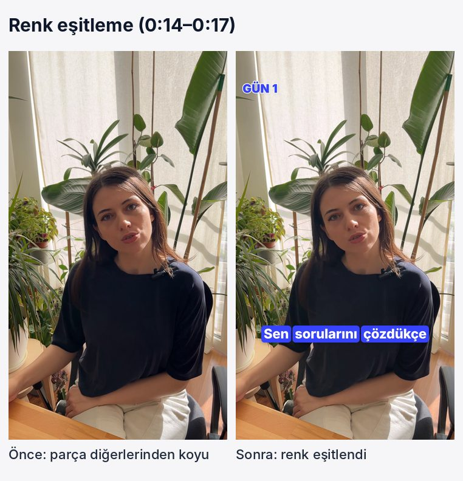

---

## 9. Kontrol ✅

**Amaç:** Videonun gerçekten izleneceği yerde, telefonda çalıştığından emin olmak.
**Girdi → Çıktı:** `final.mp4` → final onayı ya da düzeltme listesi

**Yap**
1. Telefonda **sesli** izle: ritim, müzik seviyesi, efektler baskın mı?
2. Telefonda **sessiz** izle: hikâye sadece yazılarla anlaşılıyor mu?
3. Güvenli alanlara bak: hiçbir şey platform butonlarının ve açıklama metninin altında değil ([safe-zones](../rules/safe-zones.md)).
4. Yönetmen gözüyle bak: hook ilk saniyede yakalıyor mu, yüz çok uzun süre kapanıyor mu, düşen yer var mı?

**Kontrol**
- [ ] ✅ Final onayı

**Gün 1'de:**

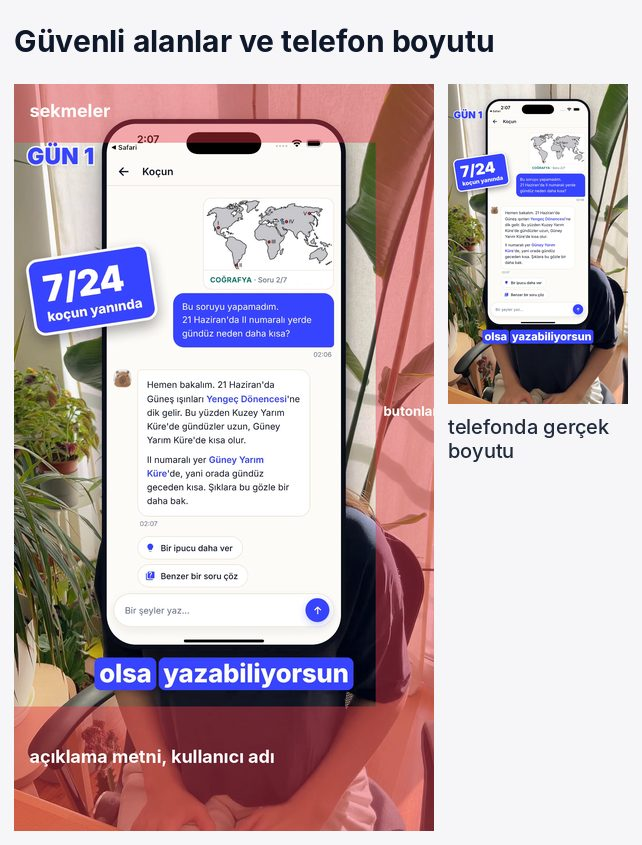

Bu adımdaki her geri bildirim bir düzeltme, tekrar edenler bir kural oldu:

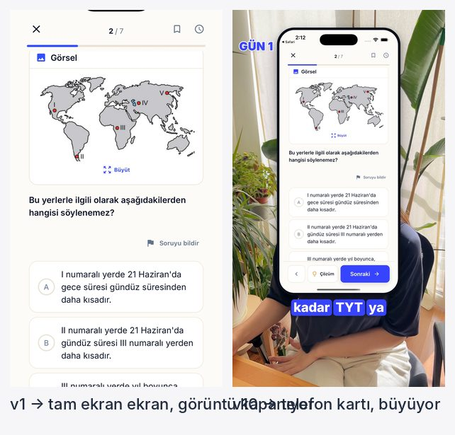
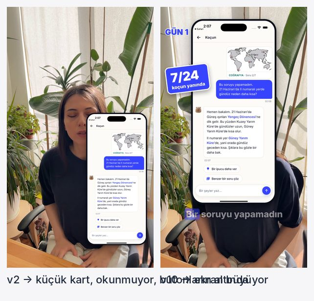
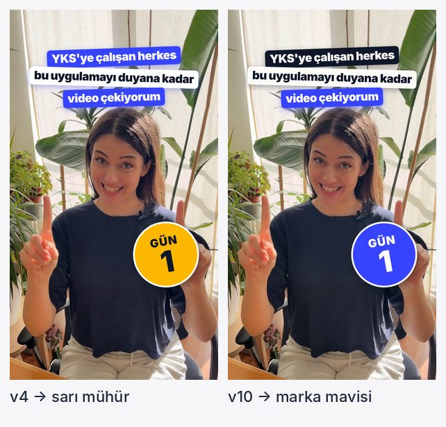
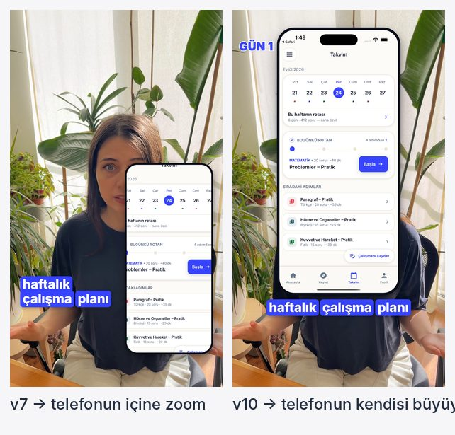
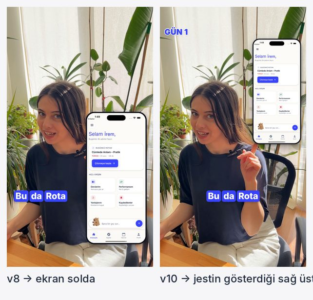

Bütün sürümler ve hangi kurala dönüştükleri: [örnek, bölüm 4](../examples/rota-day-1/README.md#4-neler-denendi-neler-kurala-dönüştü).

---

## 10. Yayın ve kayıt

**Amaç:** Yayınlamak ve sonuçtan öğrenmek.
**Girdi → Çıktı:** final video → yayın + güncellenmiş günlük

**Yap**
1. Paylaşım kopyası: 1080×1920, 30 fps, H.264, 30 MB altı.
2. Başlık ve açıklamaları serinin `bible.md`'sindeki kalıplardan yaz (TikTok'ta link yok, YouTube'da var).
3. Final dosyayı marka paketindeki bölüm klasörüne kaydet; taslakları sil.
4. Serinin `log.md`'sine bu bölümde kullanılan hook, vurgu, geçiş ve müziği yaz.
5. ~48 saat sonra metrikleri ekle: ilk 3 sn'de kalma, ortalama izlenme, tamamlanma, yorum/kayıt ([learning](../learning/README.md)).
6. Bu bölümde yeni bir teknik ya da vurgu tipi doğduysa ilgili README'ye ekle.

**Kontrol**
- [ ] `log.md` güncel
- [ ] Yeni öğeler kütüphaneye işlendi

**Gün 1'de:** Başlık "Herkes Rota'yı duyana kadar: Gün 1". Beş vurgu tipi ve iki geçiş tipi ilk kez kütüphaneye girdi.
